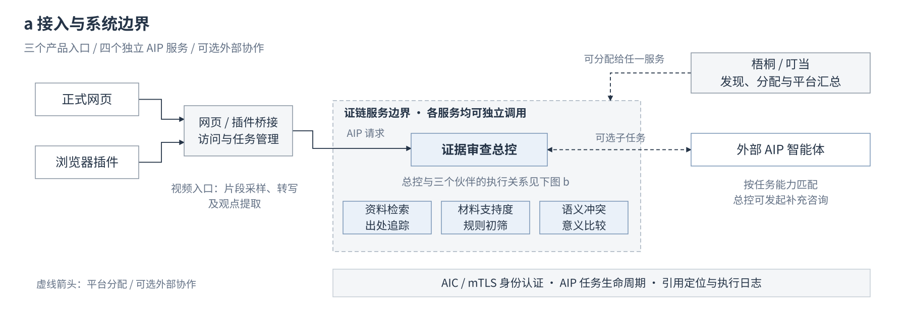
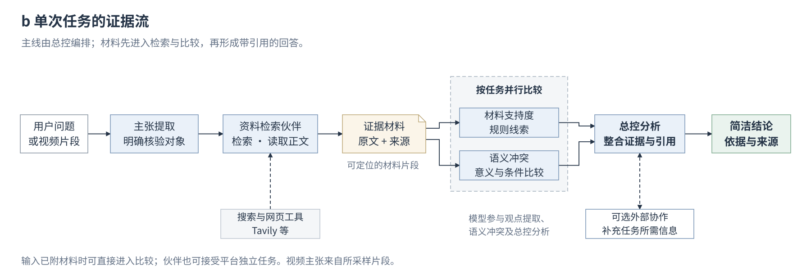
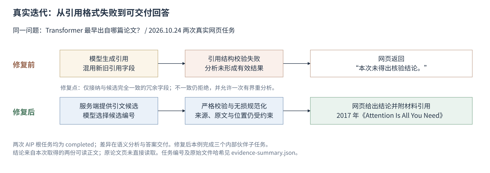

# 系统设计与自主实现

网页与浏览器插件经受保护的桥接服务访问同一AIP总控。梧桐/叮当能够发现并分别调用四个独立服务；叮当对成员的任务分配不能等同于总控自行派发子任务。

典型任务从主张提取进入资料检索；实际正文带来源与定位信息交给材料支持度和语义冲突伙伴，总控整合分析并交付带引用的可读回答。已有正文时可跳过检索；不要求每题都调用全部伙伴。

| 模块 | 自主实现位置 | 与上游能力的边界 |
|---|---|---|
| AIP接入与任务 | `aip_partner.py`、`leader_app.py`、`runtime_config.py` | 复用ACPs SDK，应用层完成专业服务和配置适配 |
| 输入与材料交接 | `contracts.py`、`collaboration_input.py`、`leader_input.py` | 保留真实上游材料与来源；标题和任务说明不冒充原文 |
| 检索与出处 | `public_evidence.py`、`provider_documents.py`、`tavily_search.py` | 搜索提供商和网页内容来自外部；文献元数据不等于全文 |
| 意义比较 | `semantic_conflict.py`、`semantic_review.py` | 模型是外部服务；候选引用、校验、范围和任务组织由本工程实现 |
| 数量推理 | `quantity_reasoning.py` | 容许有证据的子集/整体推理，不能只按文字是否相同判断 |
| 混合协作 | `hybrid_collaboration.py`、`external_consultation.py` | 按能力接入独立外部AIP服务，保留其任务关系及实际返回状态 |
| 视频入口 | `browser-extension/`、`video_observation.py`、`audio_transcription.py` | 有限采样与自动提取；不是完整视频理解或真伪鉴定 |
| 展示与恢复 | `product_presentation.py`、`result_presentation.py`、`web_task_recovery.py` | 可读答案为正文，完整机器契约放协议元数据；不向用户输出整份后台JSON |

Python模块均位于`src/evidence_mesh/`。材料支持度伙伴当前是规则初筛，语义冲突伙伴在模型未配置时明确标记未检查。

## 一例真实修复

2026-10-24，同一句论文出处问题的两次网页执行暴露引用契约不兼容。两次根任务协议状态均completed；第一次模型混合新旧引用字段，分析校验失败。修复后由服务端生成实际候选编号，仅规范化与候选完全一致的冗余字段，不一致仍拒绝，并允许一次有界重分析。第二次交付论文标题、年份及实际材料引用。

本例不是总体准确率证明。该次网页读取了两份可读正文，未直接取得原论文页。私有原始记录保留在维护者本地，公开图不包含访问凭据。

## 开源归属

ACPs-community SDK与规范归上游；本仓库自研的专业任务、材料流、校验、恢复及界面代码按Apache-2.0发布。版本与许可证见根目录NOTICE和requirements.txt。不要把搜索、模型或上游SDK能力宣称为团队自研算法。
